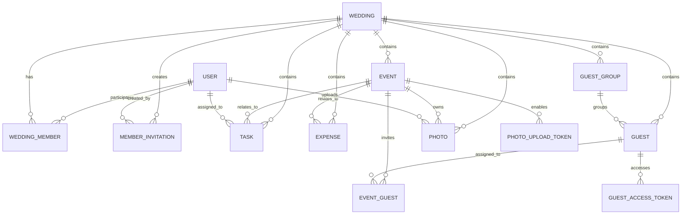

# Plan My Marriage — Database Design Document

**Version:** 1.0  
**Database:** MongoDB Atlas  
**ODM:** Mongoose  
**Application:** Next.js modular monolith  
**Language:** TypeScript  
**Validation:** Zod at API boundaries + Mongoose persistence validation  
**Media:** Cloudflare R2; MongoDB stores metadata only

---

## 1. Purpose

This document defines the MongoDB database design for **Plan My Marriage**. It translates the approved PRD and System Design Architecture into concrete collections, fields, relationships, indexes, integrity rules, token storage, query patterns, and Mongoose conventions.

The design is optimized for:

- simple wedding planning for Indian families;
- one shared wedding workspace for Admins and Managers;
- multi-event guest assignment and RSVP;
- token-protected guest experiences without guest accounts;
- image-heavy wedding galleries backed by Cloudflare R2;
- logical multi-tenancy where each Wedding is a tenant boundary;
- a modular monolith that can scale without prematurely introducing microservices.

---

## 2. Core Database Principles

### 2.1 Wedding is the tenant boundary

Most domain collections carry `weddingId`, even when the wedding could technically be discovered through another relation such as `eventId`.

This is intentional. It makes authorization and query scoping explicit:

```ts
{ _id: resourceId, weddingId }
```

instead of:

```ts
{ _id: resourceId }
```

Every authenticated wedding-scoped read or mutation must first verify the user's `WeddingMember` record and then scope the database operation by `weddingId`.

### 2.2 Users and Guests are different concepts

A **User** has an account and can authenticate.

Users are:

- Bride / Groom acting as `ADMIN`;
- invited family members acting as `MANAGER`.

A **Guest** is a person invited to wedding events and does **not** need an account.

```text
User != Guest
```

### 2.3 Roles belong to the wedding membership

Do not store a single global role on `User`.

A person can be:

- `ADMIN` in their own wedding;
- `MANAGER` in a sibling's wedding;
- `MANAGER` in a cousin's wedding.

Therefore role is stored on `WeddingMember`.

### 2.4 Do not embed unbounded arrays

Do not embed hundreds of guests, photos, tasks, or RSVP records inside `Wedding` or `Event` documents.

Use separate collections for data that can grow independently.

### 2.5 Store media metadata, not image bytes

MongoDB never stores wedding images themselves.

Cloudflare R2 stores image objects. MongoDB stores fields such as:

- `objectKey`;
- `weddingId`;
- `eventId`;
- MIME type;
- size;
- upload source;
- timestamps.

The full CDN URL is derived at runtime from the configured media base URL and `objectKey`.

### 2.6 Tokens are hashed

Raw guest/member/photo-upload tokens must never be stored in MongoDB.

The application:

1. generates a cryptographically random token;
2. gives the raw token to the URL/email/QR code;
3. stores only `SHA-256(rawToken)` as `tokenHash`;
4. hashes incoming tokens before database lookup.

### 2.7 Money is stored as integer paise

Expense amounts must not use floating-point rupee values.

Example:

```text
₹80,000.50 -> 8000050 paise
```

Store:

```ts
amountPaise: 8000050
currency: "INR"
```

This avoids floating-point rounding errors.

### 2.8 Dates are stored in UTC

MongoDB `Date` values are stored as UTC timestamps.

Wedding/event presentation can default to `Asia/Kolkata`, but persistence should use real timestamps rather than formatted date strings.

---

## 3. Collection Inventory

| Collection | Purpose |
|---|---|
| `users` | Authenticated application users |
| `weddings` | Wedding profile, theme, slug and public-site configuration |
| `weddingMembers` | User-to-wedding membership and ADMIN/MANAGER role |
| `memberInvitations` | Tokenized invitations for Managers |
| `events` | Wedding ceremonies/events |
| `tasks` | Planning tasks |
| `expenses` | Simple expense records |
| `guestGroups` | Organizer-defined groups such as "Rajesh Uncle Family" or "College Friends" |
| `guests` | Master guest list |
| `eventGuests` | Guest-to-event invitation relation and RSVP state |
| `guestAccessTokens` | Token-protected guest invitation/RSVP capability |
| `photoUploadTokens` | Event-scoped guest photo-upload capability |
| `photos` | Metadata for R2-backed images |
| `rateLimitBuckets` | Shared fixed-window rate-limiting counters |

### Deliberately absent collections

The following do **not** need standalone collections in V1:

- `rsvps` — RSVP state belongs on `eventGuests`;
- `galleries` — a gallery is a query over `photos`, grouped by event;
- `themes` — theme is an enum/configuration in the application and a field on `weddings`;
- `vendors` — V1 vendor data is fetched from an external provider rather than persisted as a marketplace;
- `venues` — venue data is embedded in the relevant `event`;
- `invitations` — guest invitation capability is represented by `guestAccessTokens`; Manager invitations use `memberInvitations`.

---

## 4. High-Level Relationship Diagram



---

# 5. Collection Designs

## 5.1 `users`

Stores authenticated users only.

### Fields

| Field | Type | Required | Notes |
|---|---|---:|---|
| `_id` | ObjectId | Yes | MongoDB identifier |
| `displayName` | String | Yes | User-facing name |
| `email` | String | Yes | Lowercased/normalized |
| `passwordHash` | String | Yes | Adaptive password hash; never expose |
| `sessionVersion` | Number | Yes | Default `1`; increment to invalidate all sessions |
| `createdAt` | Date | Yes | Mongoose timestamp |
| `updatedAt` | Date | Yes | Mongoose timestamp |

### Example

```json
{
  "_id": "68d0a0010000000000000001",
  "displayName": "Ritik Sharma",
  "email": "ritik@example.com",
  "passwordHash": "<argon2-or-bcrypt-hash>",
  "sessionVersion": 1,
  "createdAt": "2026-09-21T06:00:00.000Z",
  "updatedAt": "2026-09-21T06:00:00.000Z"
}
```

### Indexes

```js
{ email: 1 } // unique
```

### Rules

- `email` is normalized before persistence.
- `User` contains no global `role` field.
- password hashes, session internals and security fields are never returned from normal API serializers.

---

## 5.2 `weddings`

Represents one wedding workspace and its guest-facing website configuration.

### Fields

| Field | Type | Required | Notes |
|---|---|---:|---|
| `_id` | ObjectId | Yes | Wedding ID / tenant ID |
| `brideName` | String | Yes | Bride display name |
| `groomName` | String | Yes | Groom display name |
| `weddingDate` | Date | Yes | Primary wedding date |
| `city` | String | Yes | Primary wedding city/location |
| `slug` | String | Yes | Public URL slug; normalized lowercase |
| `theme` | Enum | Yes | `CLASSIC_INDIAN`, `MODERN_MINIMAL`, `ROYAL_INDIAN` |
| `description` | String | No | Short guest-facing description |
| `couplePhotoId` | ObjectId | No | Reference to `photos` |
| `coverPhotoId` | ObjectId | No | Reference to `photos` |
| `website.isPublished` | Boolean | Yes | Default `false` |
| `website.showGallery` | Boolean | Yes | Default `true` |
| `website.showLivestream` | Boolean | Yes | Default `true` |
| `timezone` | String | Yes | Default `Asia/Kolkata` |
| `createdBy` | ObjectId | Yes | User who created the wedding |
| `createdAt` | Date | Yes | Timestamp |
| `updatedAt` | Date | Yes | Timestamp |

### Example

```json
{
  "_id": "68d0b0010000000000000001",
  "brideName": "Priya",
  "groomName": "Ritik",
  "weddingDate": "2027-02-14T12:00:00.000Z",
  "city": "Delhi",
  "slug": "ritik-weds-priya",
  "theme": "CLASSIC_INDIAN",
  "description": "Join us as we celebrate our wedding.",
  "couplePhotoId": null,
  "coverPhotoId": null,
  "website": {
    "isPublished": true,
    "showGallery": true,
    "showLivestream": true
  },
  "timezone": "Asia/Kolkata",
  "createdBy": "68d0a0010000000000000001",
  "createdAt": "2026-09-21T06:05:00.000Z",
  "updatedAt": "2026-09-21T06:05:00.000Z"
}
```

### Indexes

```js
{ slug: 1 }        // unique
{ weddingDate: 1 }
```

### Rules

- `slug` is public routing information, not a secret.
- Sensitive planning data is never embedded here for public-site convenience.
- Public website queries must explicitly select publishable fields and related event/gallery data.

---

## 5.3 `weddingMembers`

Joins authenticated users to weddings and stores the role for that wedding.

### Fields

| Field | Type | Required | Notes |
|---|---|---:|---|
| `_id` | ObjectId | Yes | Membership ID |
| `weddingId` | ObjectId | Yes | Tenant boundary |
| `userId` | ObjectId | Yes | Authenticated user |
| `role` | Enum | Yes | `ADMIN` or `MANAGER` |
| `joinedAt` | Date | Yes | Membership date |
| `createdAt` | Date | Yes | Timestamp |
| `updatedAt` | Date | Yes | Timestamp |

### Example

```json
{
  "_id": "68d0c0010000000000000001",
  "weddingId": "68d0b0010000000000000001",
  "userId": "68d0a0010000000000000001",
  "role": "ADMIN",
  "joinedAt": "2026-09-21T06:05:00.000Z"
}
```

### Indexes

```js
{ weddingId: 1, userId: 1 } // unique
{ userId: 1, joinedAt: -1 }
```

### Rules

- Creating a wedding creates the creator's `ADMIN` membership in the same operation/transaction.
- An `ADMIN` may remove a `MANAGER`.
- A `MANAGER` cannot remove an `ADMIN`.
- Authorization always evaluates membership for the target `weddingId`.

---

## 5.4 `memberInvitations`

Stores pending Manager invitations sent by email through Resend.

### Fields

| Field | Type | Required | Notes |
|---|---|---:|---|
| `_id` | ObjectId | Yes | Invitation ID |
| `weddingId` | ObjectId | Yes | Wedding receiving the Manager |
| `email` | String | Yes | Normalized invited email |
| `role` | Enum | Yes | V1 value: `MANAGER` |
| `tokenHash` | String | Yes | SHA-256 of raw invitation token |
| `createdBy` | ObjectId | Yes | Admin who sent invitation |
| `sentAt` | Date | No | Set after successful Resend request |
| `providerMessageId` | String | No | Resend message ID |
| `expiresAt` | Date | Yes | Recommended: 7 days |
| `acceptedAt` | Date | No | Set when accepted |
| `revokedAt` | Date | No | Set when revoked |
| `createdAt` | Date | Yes | Timestamp |
| `updatedAt` | Date | Yes | Timestamp |

### Indexes

```js
{ tokenHash: 1 }                    // unique
{ expiresAt: 1 }                    // TTL
{ weddingId: 1, email: 1, createdAt: -1 }
```

### Rules

- Raw token is never persisted.
- Accepting an invitation verifies the signed-in user's normalized email matches the invitation email.
- Accepting performs a transaction:
  1. create `WeddingMember` if not already present;
  2. set `acceptedAt`.
- Duplicate active Manager invitations should be prevented at the service layer.

---

## 5.5 `events`

Stores wedding ceremonies such as Haldi, Mehendi, Sangeet, Wedding and Reception.

### Fields

| Field | Type | Required | Notes |
|---|---|---:|---|
| `_id` | ObjectId | Yes | Event ID |
| `weddingId` | ObjectId | Yes | Tenant boundary |
| `name` | String | Yes | Display name |
| `type` | String/Enum | Yes | Default event type or `CUSTOM` |
| `startsAt` | Date | Yes | UTC timestamp |
| `endsAt` | Date | No | UTC timestamp |
| `description` | String | No | Plain text |
| `dressCode` | String | No | Guest-facing |
| `venue.name` | String | No | Venue name |
| `venue.address` | String | No | Human-readable address |
| `venue.mapUrl` | String | No | Maps URL |
| `eventPhotoId` | ObjectId | No | Optional event display image |
| `livestreamUrl` | String | No | External livestream URL |
| `createdBy` | ObjectId | Yes | User |
| `createdAt` | Date | Yes | Timestamp |
| `updatedAt` | Date | Yes | Timestamp |

### Example

```json
{
  "_id": "68d0d0010000000000000001",
  "weddingId": "68d0b0010000000000000001",
  "name": "Sangeet",
  "type": "SANGEET",
  "startsAt": "2027-02-13T13:30:00.000Z",
  "endsAt": "2027-02-13T18:00:00.000Z",
  "description": "An evening of music and celebration.",
  "dressCode": "Indo-Western",
  "venue": {
    "name": "ABC Banquet",
    "address": "New Delhi, Delhi",
    "mapUrl": "https://maps.google.com/..."
  },
  "livestreamUrl": null,
  "createdBy": "68d0a0010000000000000001"
}
```

### Indexes

```js
{ weddingId: 1, startsAt: 1 }
```

### Rules

- Event name does not need to be unique; a family may create custom ceremonies.
- `endsAt`, when present, must be after `startsAt`.
- Venue is embedded because it has no independent lifecycle in V1.
- `livestreamUrl` is an external URL only; Plan My Marriage does not host livestreams.

---

## 5.6 `tasks`

Stores wedding planning tasks.

### Fields

| Field | Type | Required | Notes |
|---|---|---:|---|
| `_id` | ObjectId | Yes | Task ID |
| `weddingId` | ObjectId | Yes | Tenant boundary |
| `eventId` | ObjectId | No | Optional event relation |
| `title` | String | Yes | Task title |
| `description` | String | No | Plain text |
| `assignedToUserId` | ObjectId | No | Must be current wedding member when assigned |
| `priority` | Enum | Yes | `LOW`, `MEDIUM`, `HIGH` |
| `status` | Enum | Yes | `TODO`, `IN_PROGRESS`, `COMPLETED` |
| `dueDate` | Date | No | UTC timestamp |
| `completedAt` | Date | No | Set when completed |
| `createdBy` | ObjectId | Yes | User |
| `createdAt` | Date | Yes | Timestamp |
| `updatedAt` | Date | Yes | Timestamp |

### Indexes

```js
{ weddingId: 1, status: 1, dueDate: 1 }
{ weddingId: 1, assignedToUserId: 1, status: 1 }
{ weddingId: 1, eventId: 1, status: 1 }
```

### Rules

- `eventId` must belong to the same wedding.
- `assignedToUserId` must be an active `WeddingMember` when assigned.
- Setting status to `COMPLETED` sets `completedAt`; moving away from completed clears it.

---

## 5.7 `expenses`

Stores simple expense entries. This is **not** a budget-planning model.

### Fields

| Field | Type | Required | Notes |
|---|---|---:|---|
| `_id` | ObjectId | Yes | Expense ID |
| `weddingId` | ObjectId | Yes | Tenant boundary |
| `eventId` | ObjectId | No | Optional event relation |
| `name` | String | Yes | Expense description |
| `category` | Enum/String | Yes | Expense category |
| `amountPaise` | Number | Yes | Integer >= 0 |
| `currency` | String | Yes | V1: `INR` |
| `expenseDate` | Date | Yes | Date of expense |
| `vendorName` | String | No | Free text; not a vendor FK |
| `paidBy` | String | No | Optional human-readable name |
| `notes` | String | No | Optional plain text |
| `createdBy` | ObjectId | Yes | User |
| `createdAt` | Date | Yes | Timestamp |
| `updatedAt` | Date | Yes | Timestamp |

### Initial categories

```text
VENUE
CATERING
DECORATION
PHOTOGRAPHY
VIDEOGRAPHY
CLOTHING
JEWELLERY
MAKEUP
MEHENDI
ENTERTAINMENT
INVITATIONS
TRAVEL
ACCOMMODATION
GIFTS
OTHER
```

### Indexes

```js
{ weddingId: 1, expenseDate: -1 }
{ weddingId: 1, category: 1 }
{ weddingId: 1, eventId: 1, expenseDate: -1 }
```

### Explicitly not stored

- total budget;
- planned amount;
- negotiated amount;
- remaining budget;
- budget forecast.

### Aggregation examples

Total wedding expense:

```js
[
  { $match: { weddingId } },
  { $group: { _id: null, totalPaise: { $sum: "$amountPaise" } } }
]
```

Category totals:

```js
[
  { $match: { weddingId } },
  { $group: { _id: "$category", totalPaise: { $sum: "$amountPaise" } } },
  { $sort: { totalPaise: -1 } }
]
```

---

## 5.8 `guestGroups`

Organizer-defined grouping for families, relatives, friends, colleagues, etc.

### Fields

| Field | Type | Required | Notes |
|---|---|---:|---|
| `_id` | ObjectId | Yes | Group ID |
| `weddingId` | ObjectId | Yes | Tenant boundary |
| `name` | String | Yes | Display name |
| `normalizedName` | String | Yes | Lowercased/trimmed for duplicate prevention |
| `createdBy` | ObjectId | Yes | User |
| `createdAt` | Date | Yes | Timestamp |
| `updatedAt` | Date | Yes | Timestamp |

Examples:

- `Rajesh Uncle Family`
- `Sharma Family - Delhi`
- `Mama Ji - Lucknow`
- `College Friends`
- `TCS Friends`

### Indexes

```js
{ weddingId: 1, normalizedName: 1 } // unique
```

### Rules

- Group names are chosen by organizers; they are not automatically derived from surname.
- Guests may exist without a group.
- Uniqueness within a wedding avoids two visually identical group names.

---

## 5.9 `guests`

Master guest list for a wedding.

### Fields

| Field | Type | Required | Notes |
|---|---|---:|---|
| `_id` | ObjectId | Yes | Guest ID |
| `weddingId` | ObjectId | Yes | Tenant boundary |
| `name` | String | Yes | Guest name |
| `phone` | String | No | Optional; store normalized form if used |
| `email` | String | No | Optional; normalized lowercase |
| `guestGroupId` | ObjectId | No | Optional `guestGroups` reference |
| `notes` | String | No | Organizer-only notes |
| `createdBy` | ObjectId | Yes | User |
| `createdAt` | Date | Yes | Timestamp |
| `updatedAt` | Date | Yes | Timestamp |

### Indexes

```js
{ weddingId: 1, name: 1 }
{ weddingId: 1, guestGroupId: 1, name: 1 }
{ weddingId: 1, email: 1 }
```

### Explicitly not stored

- food preference;
- guest account password;
- guest message to couple.

### Duplicate handling

Guest names are **not** unique. Multiple guests can legitimately share a name.

The UI may warn about likely duplicates using combinations such as normalized name + phone/email, but the database should not block them.

---

## 5.10 `eventGuests`

Many-to-many join between `Event` and `Guest`. It represents both **invitation assignment** and the guest's RSVP state for that event.

This collection replaces a separate RSVP collection.

### Fields

| Field | Type | Required | Notes |
|---|---|---:|---|
| `_id` | ObjectId | Yes | Relation ID |
| `weddingId` | ObjectId | Yes | Tenant boundary |
| `eventId` | ObjectId | Yes | Event |
| `guestId` | ObjectId | Yes | Guest |
| `rsvpStatus` | Enum | Yes | `PENDING`, `ATTENDING`, `NOT_ATTENDING` |
| `respondedAt` | Date | No | Last RSVP response time |
| `createdAt` | Date | Yes | Timestamp |
| `updatedAt` | Date | Yes | Timestamp |

### Indexes

```js
{ eventId: 1, guestId: 1 }                        // unique
{ weddingId: 1, guestId: 1 }
{ weddingId: 1, eventId: 1, rsvpStatus: 1 }
```

### Why this model

A wedding with 500 guests and 7 events can have thousands of event assignments. Embedding these arrays in `events` or `guests` would create large, frequently-changing documents.

`eventGuests` gives efficient queries in both directions:

```text
Which guests are invited to Sangeet?
Which events is Rajesh invited to?
How many guests accepted Wedding?
Which guests are still pending for Reception?
```

### Rules

- `eventId` and `guestId` must belong to the same `weddingId`.
- Guests may RSVP only to `EventGuest` records already assigned to them.
- RSVP updates never create a new event invitation implicitly.

---

## 5.11 `guestAccessTokens`

Provides accountless, token-protected invitation and RSVP access for one guest.

### Fields

| Field | Type | Required | Notes |
|---|---|---:|---|
| `_id` | ObjectId | Yes | Token record ID |
| `weddingId` | ObjectId | Yes | Tenant boundary |
| `guestId` | ObjectId | Yes | Guest capability belongs to |
| `tokenHash` | String | Yes | SHA-256 hash only |
| `expiresAt` | Date | Yes | Wedding period + configurable grace period |
| `revokedAt` | Date | No | Revocation timestamp |
| `lastUsedAt` | Date | No | Operational visibility |
| `sentAt` | Date | No | Last successful email send time |
| `providerMessageId` | String | No | Resend message ID, if emailed |
| `createdBy` | ObjectId | Yes | Admin/Manager who generated it |
| `createdAt` | Date | Yes | Timestamp |
| `updatedAt` | Date | Yes | Timestamp |

### Indexes

```js
{ tokenHash: 1 }                    // unique
{ weddingId: 1, guestId: 1, createdAt: -1 }
{ expiresAt: 1 }                    // TTL optional/recommended for V1 cleanup
```

### Capability

A valid token may:

- read invitation context for its guest;
- read only that guest's assigned events;
- update only that guest's event RSVP statuses.

It does **not** grant:

- access to the Admin/Manager application;
- other guest records;
- expenses/tasks/team data;
- general photo-upload capability unless separately granted by an event upload token.

### Rotation

When a guest link is rotated:

1. set old token `revokedAt`;
2. create a new random raw token;
3. persist only the new hash;
4. resend/share the new link.

---

## 5.12 `photoUploadTokens`

Provides token-protected guest photo upload for one event. The raw token is encoded in an event QR code or upload link.

### Fields

| Field | Type | Required | Notes |
|---|---|---:|---|
| `_id` | ObjectId | Yes | Token record ID |
| `weddingId` | ObjectId | Yes | Tenant boundary |
| `eventId` | ObjectId | Yes | Only event photos can be uploaded |
| `tokenHash` | String | Yes | SHA-256 hash only |
| `expiresAt` | Date | Yes | Event window + configurable grace period |
| `revokedAt` | Date | No | Revocation timestamp |
| `createdBy` | ObjectId | Yes | Admin/Manager |
| `createdAt` | Date | Yes | Timestamp |
| `updatedAt` | Date | Yes | Timestamp |

### Indexes

```js
{ tokenHash: 1 }                  // unique
{ weddingId: 1, eventId: 1, createdAt: -1 }
{ expiresAt: 1 }                  // TTL optional/recommended
```

### Rules

- Photo-upload tokens do not identify a guest.
- A token grants upload capability only to its event.
- Rotating a QR code revokes the old token and creates a new one.
- Photo presign/finalize endpoints apply strict token + IP rate limits.

---

## 5.13 `photos`

Stores metadata for images whose bytes are stored in Cloudflare R2.

### Fields

| Field | Type | Required | Notes |
|---|---|---:|---|
| `_id` | ObjectId | Yes | Photo metadata ID |
| `weddingId` | ObjectId | Yes | Tenant boundary |
| `eventId` | ObjectId | No | Required for event-gallery photos |
| `purpose` | Enum | Yes | See below |
| `objectKey` | String | Yes | R2 key; globally unique |
| `originalFileName` | String | No | Display/audit only; never used as R2 key |
| `mimeType` | String | Yes | V1 allowlist: JPEG/PNG/WebP |
| `sizeBytes` | Number | Yes | Verified during finalize |
| `uploadedByType` | Enum | Yes | `ADMIN`, `MANAGER`, `GUEST` |
| `uploadedByUserId` | ObjectId | No | Present for Admin/Manager uploads |
| `createdAt` | Date | Yes | Gallery order |
| `updatedAt` | Date | Yes | Timestamp |

### Purpose enum

```text
COUPLE_PHOTO
WEDDING_COVER
EVENT_COVER
EVENT_GALLERY
WEDDING_GALLERY
```

### Example

```json
{
  "_id": "68d0f0010000000000000001",
  "weddingId": "68d0b0010000000000000001",
  "eventId": "68d0d0010000000000000001",
  "purpose": "EVENT_GALLERY",
  "objectKey": "weddings/68d0b001/events/68d0d001/gallery/4d8f1f51-acde-4c0b.webp",
  "originalFileName": "IMG_1234.webp",
  "mimeType": "image/webp",
  "sizeBytes": 2841934,
  "uploadedByType": "GUEST",
  "uploadedByUserId": null,
  "createdAt": "2027-02-13T16:40:00.000Z"
}
```

### Indexes

```js
{ objectKey: 1 }                                  // unique
{ weddingId: 1, eventId: 1, createdAt: -1 }
{ weddingId: 1, purpose: 1, createdAt: -1 }
```

### CDN URL rule

Do **not** store:

```text
https://media.planmymarriage.com/...
```

Store only `objectKey`.

At runtime:

```ts
const url = `${MEDIA_CDN_BASE_URL}/${photo.objectKey}`;
```

This allows the CDN/domain to change without database migration.

### R2 object-key strategy

Recommended patterns:

```text
weddings/{weddingId}/cover/{uuid}.{ext}
weddings/{weddingId}/couple/{uuid}.{ext}
weddings/{weddingId}/events/{eventId}/cover/{uuid}.{ext}
weddings/{weddingId}/events/{eventId}/gallery/{uuid}.{ext}
weddings/{weddingId}/gallery/{uuid}.{ext}
```

Original file names are never authoritative object keys.

---

## 5.14 `rateLimitBuckets`

Stores distributed fixed-window rate-limit counters shared across Next.js application instances.

### Fields

| Field | Type | Required | Notes |
|---|---|---:|---|
| `_id` | String | Yes | Hash of policy + identity + window start |
| `count` | Number | Yes | Atomic request count |
| `expiresAt` | Date | Yes | TTL cleanup |
| `createdAt` | Date | No | Optional diagnostics |

### Index

```js
{ expiresAt: 1 } // TTL
```

### Identity examples

```text
Login           -> normalized IP + normalized email
Guest RSVP      -> IP + token fingerprint
Photo upload    -> IP + photo-token fingerprint
Send invitation -> userId + weddingId
Vendor search   -> userId + weddingId
```

### Update pattern

Use atomic `findOneAndUpdate` with `$inc` and `upsert` so multiple application instances share the same counter safely.

---

# 6. Embedded Data vs Separate Collections

| Data | Design | Reason |
|---|---|---|
| Wedding website flags | Embedded in `weddings` | Small, bounded, same lifecycle |
| Event venue | Embedded in `events` | Venue belongs to event in V1 |
| Users in wedding | `weddingMembers` collection | Many-to-many + role |
| Guests | Separate collection | Potentially 1,000+ records |
| Guests per event | `eventGuests` collection | Many-to-many + RSVP |
| Tasks | Separate collection | Independent lifecycle/filtering |
| Expenses | Separate collection | Independent lifecycle/aggregation |
| Photos | Separate collection | Thousands per wedding possible |
| Gallery | No collection | Derived from `photos` |
| RSVP | No collection | Stored on `eventGuests` |
| Vendor results | Not persisted V1 | External provider is source |
| Themes | Enum/config | Only three predefined themes initially |

---

# 7. Tenant Isolation and Authorization Rules

## 7.1 Authenticated query pattern

Never fetch a wedding-scoped resource using only its `_id`.

Bad:

```ts
Task.findById(taskId)
```

Good:

```ts
Task.findOne({
  _id: taskId,
  weddingId
})
```

Request flow:

```text
Session
  -> userId
  -> WeddingMember lookup for weddingId
  -> authorization check
  -> weddingId-scoped repository query
```

## 7.2 Cross-reference validation

Before persistence, service-layer rules verify references belong to the same wedding.

Examples:

- a Task's `eventId` belongs to `task.weddingId`;
- a Task's assignee is a `WeddingMember` of that wedding;
- an Expense's `eventId` belongs to the same wedding;
- a Guest's `guestGroupId` belongs to the same wedding;
- an `EventGuest` event and guest belong to the same wedding;
- a Photo's `eventId` belongs to the same wedding.

MongoDB does not enforce foreign keys, so these checks belong in domain services.

---

# 8. Key Read Models / Query Patterns

## 8.1 Dashboard

The dashboard should execute a few focused queries/aggregations rather than loading entire collections.

### Task counts

```js
Task.aggregate([
  { $match: { weddingId } },
  { $group: { _id: "$status", count: { $sum: 1 } } }
])
```

Overdue tasks are:

```js
{
  weddingId,
  status: { $ne: "COMPLETED" },
  dueDate: { $lt: now }
}
```

### Total expenses

```js
Expense.aggregate([
  { $match: { weddingId } },
  { $group: { _id: null, totalPaise: { $sum: "$amountPaise" } } }
])
```

### RSVP counts

```js
EventGuest.aggregate([
  { $match: { weddingId } },
  { $group: { _id: "$rsvpStatus", count: { $sum: 1 } } }
])
```

Note: this counts **event invitations**, not unique people. If the dashboard needs unique guest-level confirmation, define the UX explicitly before using this aggregate. Event-level RSVP is the source of truth.

### Upcoming events

```js
Event.find({
  weddingId,
  startsAt: { $gte: now }
})
.sort({ startsAt: 1 })
.limit(5)
```

---

## 8.2 Guest invitation context

Given a valid `guestAccessToken`:

1. lookup `GuestAccessToken` by `tokenHash`;
2. validate `expiresAt` / `revokedAt`;
3. load `Guest` by `{ _id: guestId, weddingId }`;
4. load assigned `EventGuest` rows;
5. load only matching `Event` documents;
6. return wedding public details + guest + assigned events + RSVP states.

The guest must never see events that do not have an `EventGuest` row for them.

---

## 8.3 Gallery

Wedding gallery:

```js
Photo.find({
  weddingId,
  purpose: { $in: ["EVENT_GALLERY", "WEDDING_GALLERY"] }
})
.sort({ createdAt: -1 })
.limit(pageSize)
```

Event gallery:

```js
Photo.find({
  weddingId,
  eventId,
  purpose: "EVENT_GALLERY"
})
.sort({ createdAt: -1 })
```

Use cursor-based pagination by `_id`/`createdAt` once galleries become large.

---

## 8.4 Guest groups

List groups with guests using two queries or an aggregation. Avoid embedding guest arrays in `guestGroups`.

---

# 9. Write Flows and Transaction Boundaries

MongoDB transactions should be used only when a multi-document invariant genuinely requires atomicity.

## 9.1 Create wedding

Recommended transaction:

```text
create Wedding
+ create WeddingMember(role=ADMIN, creator)
```

Either both exist or neither exists.

## 9.2 Accept Manager invitation

Transaction:

```text
validate MemberInvitation
-> create WeddingMember if absent
-> mark invitation acceptedAt
```

## 9.3 RSVP

A guest may update multiple `EventGuest` rows in one request.

For a small number of event responses, `bulkWrite` is sufficient. A transaction is optional because each status update is independently idempotent, but a transaction may be used if the UX requires all-or-nothing submission.

## 9.4 Photo upload finalize

Do not create `Photo` metadata before the R2 upload exists.

Flow:

```text
presign
-> browser uploads to R2
-> finalize request
-> R2 HEAD verifies object
-> create Photo metadata
```

`objectKey` uniqueness makes finalize idempotent.

## 9.5 Delete photo

Recommended flow:

1. authorize wedding membership;
2. delete R2 object;
3. delete `Photo` metadata.

If R2 deletion succeeds and MongoDB deletion transiently fails, retry safely using `objectKey`.

---

# 10. Deletion and Referential Cleanup

MongoDB has no automatic foreign-key cascades. Domain services own cleanup rules.

## 10.1 Removing a Manager

Delete the `WeddingMember` record.

Historical Tasks/Photos may retain that user's ID for audit/display. The user simply loses future authorization for that wedding.

## 10.2 Deleting a Guest

Before hard delete:

- delete corresponding `eventGuests`;
- revoke/delete `guestAccessTokens`;
- then delete `guest`.

A transaction is appropriate because the relationship set is small.

## 10.3 Deleting a Guest Group

Do not delete its guests.

Instead:

```text
Guest.guestGroupId -> null
```

then delete the group.

## 10.4 Deleting an Event

Because Events can have many related records, V1 should use a controlled service operation.

Recommended behavior:

- delete associated `eventGuests`;
- revoke `photoUploadTokens`;
- set `eventId = null` on Tasks and Expenses if those records should be preserved;
- delete event-specific Photo metadata and R2 objects only after explicit user confirmation;
- delete the Event last.

If this becomes operationally expensive, evolve to asynchronous cleanup later. Do not introduce a queue only for V1.

---

# 11. Mongoose Conventions

## 11.1 Common schema options

Recommended:

```ts
{
  timestamps: true,
  strict: true
}
```

Use explicit field definitions and enums.

## 11.2 Production indexes

Do not rely on Mongoose `autoIndex` to silently create production indexes on every application boot.

Recommended approach:

- development: `autoIndex: true` is acceptable;
- production: set `autoIndex: false`;
- create/apply indexes intentionally during deployment or migration setup.

## 11.3 Repository/query style

Prefer narrow repository functions rather than direct model access throughout route handlers.

Example:

```ts
findTaskByWedding(taskId, weddingId)
listGuestsForWedding(weddingId, filters)
listEventGuests(eventId, weddingId)
```

This makes tenant scoping difficult to forget.

## 11.4 `populate`

Use Mongoose `populate` selectively. Avoid deeply nested population chains for dashboard/public pages.

For performance-sensitive reads, prefer explicit queries/aggregations and `.lean()`.

---

# 12. Validation Responsibilities

Validation exists at three levels.

## 12.1 Zod — request boundary

Validates user-controlled input before business logic.

Examples:

```text
CreateWeddingSchema
CreateEventSchema
TaskSchema
ExpenseSchema
GuestSchema
RSVPSchema
UploadRequestSchema
```

## 12.2 Domain service — business rules

Examples:

- user is a member of the wedding;
- only Admin can remove Manager;
- assigned task user belongs to same wedding;
- guest is actually invited to submitted RSVP events;
- upload token belongs to requested event;
- R2 object key belongs to expected wedding/event prefix.

## 12.3 Mongoose — persistence rules

Examples:

- enum values;
- required fields;
- numeric minimums;
- string limits;
- unique/index constraints.

Client-side validation improves UX but is never authoritative.

---

# 13. Recommended Field Limits

Limits prevent accidental or malicious unbounded documents.

| Field | Suggested limit |
|---|---:|
| User display name | 100 chars |
| Wedding bride/groom names | 100 chars each |
| Wedding description | 1,000 chars |
| Event name | 120 chars |
| Event description | 2,000 chars |
| Dress code | 200 chars |
| Task title | 200 chars |
| Task description | 2,000 chars |
| Expense name | 200 chars |
| Expense notes | 2,000 chars |
| Guest name | 150 chars |
| Guest notes | 1,000 chars |
| Guest group name | 150 chars |
| Venue name | 200 chars |
| Venue address | 500 chars |
| Vendor name on expense | 200 chars |
| Paid-by text | 150 chars |

Exact limits can be tuned during implementation, but schemas should define explicit limits.

---

# 14. Index Strategy Summary

| Collection | Index | Purpose |
|---|---|---|
| `users` | `{ email: 1 }` unique | Login/user lookup |
| `weddings` | `{ slug: 1 }` unique | Public site lookup |
| `weddings` | `{ weddingDate: 1 }` | Date-oriented operations |
| `weddingMembers` | `{ weddingId: 1, userId: 1 }` unique | Authorization + integrity |
| `weddingMembers` | `{ userId: 1, joinedAt: -1 }` | User's weddings |
| `memberInvitations` | `{ tokenHash: 1 }` unique | Token lookup |
| `memberInvitations` | `{ expiresAt: 1 }` TTL | Cleanup |
| `events` | `{ weddingId: 1, startsAt: 1 }` | Event schedule |
| `tasks` | `{ weddingId: 1, status: 1, dueDate: 1 }` | Dashboard/task filters |
| `tasks` | `{ weddingId: 1, assignedToUserId: 1, status: 1 }` | Assignee tasks |
| `expenses` | `{ weddingId: 1, expenseDate: -1 }` | Expense list |
| `expenses` | `{ weddingId: 1, category: 1 }` | Category totals |
| `guestGroups` | `{ weddingId: 1, normalizedName: 1 }` unique | Group uniqueness |
| `guests` | `{ weddingId: 1, name: 1 }` | Guest search/list |
| `guests` | `{ weddingId: 1, guestGroupId: 1, name: 1 }` | Group members |
| `eventGuests` | `{ eventId: 1, guestId: 1 }` unique | Invitation integrity |
| `eventGuests` | `{ weddingId: 1, eventId: 1, rsvpStatus: 1 }` | RSVP counts/filtering |
| `eventGuests` | `{ weddingId: 1, guestId: 1 }` | Guest invitation context |
| `guestAccessTokens` | `{ tokenHash: 1 }` unique | Guest capability lookup |
| `photoUploadTokens` | `{ tokenHash: 1 }` unique | QR capability lookup |
| `photos` | `{ objectKey: 1 }` unique | Upload finalization/idempotency |
| `photos` | `{ weddingId: 1, eventId: 1, createdAt: -1 }` | Event gallery |
| `photos` | `{ weddingId: 1, purpose: 1, createdAt: -1 }` | Wedding media |
| `rateLimitBuckets` | `{ expiresAt: 1 }` TTL | Automatic cleanup |

### Index rule

Do not create indexes merely because a field exists. Add indexes for real query patterns, then review MongoDB Atlas query/slow-query insights as production usage grows.

---

# 15. Public Website Read Boundary

`/w/:slug` is public, but the database is not.

The public website service must build a **public read model** from a strict allowlist.

Allowed examples:

- bride/groom names;
- wedding date;
- selected theme;
- public description;
- published event details;
- venue/maps data intended for guests;
- livestream link if enabled;
- gallery photo `objectKey`s intended for display.

Never expose through the public slug route:

- Users;
- WeddingMembers;
- Tasks;
- Expenses;
- internal guest records;
- guest notes;
- invitation tokens;
- token hashes;
- rate-limit data;
- Resend provider message IDs.

---

# 16. Token Security Model

## 16.1 Token generation

Use at least 256 bits of cryptographically secure randomness.

Conceptual TypeScript:

```ts
const rawToken = crypto.randomBytes(32).toString("base64url");
const tokenHash = crypto
  .createHash("sha256")
  .update(rawToken)
  .digest("hex");
```

## 16.2 Lookup

Incoming raw token:

```text
raw token
  -> SHA-256
  -> indexed lookup by tokenHash
  -> verify !revokedAt
  -> verify expiresAt > now
  -> load scoped domain record
```

## 16.3 Logging

Never log:

- raw Manager invitation token;
- raw guest access token;
- raw photo-upload token;
- presigned R2 upload URL;
- password;
- session cookie.

---

# 17. R2 Finalization and Database Integrity

A successful presign response does **not** create a `Photo` record.

The `Photo` record is created only after finalization.

Finalization validates:

1. caller is authenticated or has valid upload capability;
2. `objectKey` prefix belongs to the expected wedding/event;
3. R2 object exists via HEAD;
4. actual size is within allowed limit;
5. actual content type is allowed;
6. the object key has not already been finalized.

Then:

```text
R2 object exists
+ Photo metadata exists
= visible gallery photo
```

An orphaned R2 object without a `Photo` record is invisible to the application and can be cleaned later.

---

# 18. Expected Scale and Document Growth

Initial design assumptions:

| Dimension | Design assumption, not a product hard limit |
|---|---:|
| Guests per wedding | ~1,000 |
| Events per wedding | ~25 |
| Photos per wedding | ~5,000 early production |
| Concurrent event uploads | Tens to ~100 |
| Active weddings before architecture review | ~10,000 |

These values support the decision to keep guests, invitations, photos and tasks in separate collections instead of embedding them inside Wedding documents.

---

# 19. Optional Activity Feed — Deferred Decision

The PRD mentions recent dashboard activity such as:

- "Rahul completed Confirm DJ";
- "Priya added 15 guests";
- "Wedding venue updated".

For the first implementation, this does **not** need to be a source-of-truth collection. The dashboard can show recent Tasks/Guests/Expenses based on `updatedAt`.

If a unified activity feed becomes important, add a lightweight append-only collection later:

```text
activityLogs
- weddingId
- actorUserId
- type
- entityType
- entityId
- summary
- createdAt
```

This is intentionally deferred so activity logging does not complicate initial writes.

---

# 20. Collections We Should Not Add Prematurely

Do not introduce these until there is a concrete requirement:

```text
budgets
payments
vendorShortlists
vendorQuotes
vendorBookings
foodPreferences
guestAccounts
galleries
rsvps
notifications
emailQueues
refreshTokens
chatMessages
```

The current model already covers the approved V1 without them.

---

# 21. Suggested TypeScript Domain Enums

```ts
export const WeddingRole = {
  ADMIN: "ADMIN",
  MANAGER: "MANAGER",
} as const;

export const WeddingTheme = {
  CLASSIC_INDIAN: "CLASSIC_INDIAN",
  MODERN_MINIMAL: "MODERN_MINIMAL",
  ROYAL_INDIAN: "ROYAL_INDIAN",
} as const;

export const TaskPriority = {
  LOW: "LOW",
  MEDIUM: "MEDIUM",
  HIGH: "HIGH",
} as const;

export const TaskStatus = {
  TODO: "TODO",
  IN_PROGRESS: "IN_PROGRESS",
  COMPLETED: "COMPLETED",
} as const;

export const RSVPStatus = {
  PENDING: "PENDING",
  ATTENDING: "ATTENDING",
  NOT_ATTENDING: "NOT_ATTENDING",
} as const;

export const PhotoUploadSource = {
  ADMIN: "ADMIN",
  MANAGER: "MANAGER",
  GUEST: "GUEST",
} as const;
```

Keep enum definitions centralized and reuse their literal values in Zod and Mongoose schemas.

---

# 22. Suggested Mongoose Project Layout

```text
src/
  modules/
    auth/
      user.model.ts
    weddings/
      wedding.model.ts
      wedding-member.model.ts
      member-invitation.model.ts
    events/
      event.model.ts
    tasks/
      task.model.ts
    expenses/
      expense.model.ts
    guests/
      guest.model.ts
      guest-group.model.ts
      event-guest.model.ts
      guest-access-token.model.ts
    gallery/
      photo.model.ts
      photo-upload-token.model.ts
    rate-limit/
      rate-limit-bucket.model.ts

  lib/
    db/
      mongoose.ts
```

Models remain close to their domain modules rather than being placed in one giant global `models/` directory.

---

# 23. Schema Creation Order

Recommended implementation sequence:

1. `users`
2. `weddings`
3. `weddingMembers`
4. `memberInvitations`
5. `events`
6. `tasks`
7. `expenses`
8. `guestGroups`
9. `guests`
10. `eventGuests`
11. `guestAccessTokens`
12. `photoUploadTokens`
13. `photos`
14. `rateLimitBuckets`

This sequence follows product dependency order and keeps early implementation testable.

---

# 24. End-to-End Data Example

For one wedding:

```text
Wedding: Ritik + Priya
weddingId = W1

Users
- U1 Ritik
- U2 Priya
- U3 Rahul

WeddingMembers
- W1 + U1 -> ADMIN
- W1 + U2 -> ADMIN
- W1 + U3 -> MANAGER

Events
- E1 Sangeet
- E2 Wedding

GuestGroup
- GG1 Rajesh Uncle Family

Guests
- G1 Rajesh -> GG1
- G2 Sunita -> GG1
- G3 Amit -> no group

EventGuests
- E1 + G1 -> ATTENDING
- E1 + G2 -> ATTENDING
- E2 + G1 -> ATTENDING
- E2 + G2 -> PENDING
- E2 + G3 -> NOT_ATTENDING

GuestAccessToken
- GT1 -> G1
- GT2 -> G2
- GT3 -> G3

PhotoUploadToken
- PT1 -> E1 Sangeet QR
- PT2 -> E2 Wedding QR

Photos
- P1 -> W1/E1, uploadedBy=GUEST, objectKey in R2
- P2 -> W1/E1, uploadedBy=MANAGER, objectKey in R2
```

This illustrates the central design idea: **Wedding is the tenant; EventGuest connects event attendance; capability tokens give guests narrow access; R2 owns media bytes; MongoDB owns metadata and business state.**

---

# 25. Final Database Architecture

```text
MongoDB Atlas
|
|-- users
|
|-- weddings ----------------------------- tenant root
|    |
|    |-- weddingMembers ------------------ Admin / Manager access
|    |-- memberInvitations --------------- Manager onboarding
|    |-- events -------------------------- ceremonies
|    |    |
|    |    |-- eventGuests ---------------- invitations + RSVP
|    |    |-- photoUploadTokens ---------- QR guest upload capability
|    |    `-- photos --------------------- R2 metadata
|    |
|    |-- tasks
|    |-- expenses
|    |-- guestGroups
|    |-- guests
|    |    `-- guestAccessTokens ---------- invitation + RSVP capability
|    |
|    `-- photos -------------------------- wedding-level media
|
`-- rateLimitBuckets --------------------- shared API protection

Cloudflare R2
`-- actual image objects

Cloudflare CDN
`-- reads image objects using objectKey
```

---

# 26. Final Decisions

The V1 database design intentionally uses a small number of focused collections and avoids premature abstractions.

Key decisions are:

1. **MongoDB Atlas is the single application database.**
2. **Wedding is the logical tenant boundary.**
3. **Roles live on `WeddingMember`, not `User`.**
4. **Guests do not become Users.**
5. **EventGuest models both event invitation and RSVP.**
6. **There is no separate RSVP collection.**
7. **There is no separate Gallery collection.**
8. **Cloudflare R2 stores image bytes; MongoDB stores Photo metadata.**
9. **MongoDB stores R2 object keys, not hard-coded CDN URLs.**
10. **Guest and invitation tokens are stored only as hashes.**
11. **Expenses remain simple and store integer paise, with no budget-planning fields.**
12. **Guest groups use organizer-defined names rather than surnames.**
13. **Zod validates external input; Mongoose enforces persistence constraints; services enforce business rules.**
14. **Rate limiting uses a MongoDB-backed fixed-window collection in V1.**
15. **Vendor discovery remains provider-backed and does not create a vendor marketplace schema.**

This database model is the recommended persistence foundation for the Plan My Marriage V1 implementation.


## Implemented team invitation clarification (2026-10-17)

memberInvitations.role now supports ADMIN and MANAGER. Add deliveryState SENDING (default), SENT, FAILED. Only non-null sentAt records can be accepted. Provider ids remain internal; raw provider errors are never persisted. Install unique tokenHash, expiresAt TTL, and weddingId/email/createdAt indexes with npm run db:team-indexes.

Create/resend/revoke/accept and member removal serialize through a parent Wedding write inside a transaction. Authorization is rechecked in the transaction. Resend revokes the old record and creates a new one; provider calls occur outside transactions. Failures leave FAILED with null sentAt; finalizing success requires not revoked. Membership removal retains accounts and historical data. Accepted links cannot restore removed membership or upgrade existing roles. WeddingMember retains unique weddingId/userId. No global account role is introduced.


## Individual guest email metadata (2026-10-19)

The existing guestAccessTokens collection now implements providerMessageId (internal/select:false) and adds optional emailRequestId (UUID), emailRecipient (address snapshot), and emailStatus (SENDING, SENT, FAILED). Manual capabilities do not have these fields. sentAt/providerMessageId are set only after provider acceptance. Failure or unconfirmed delivery revokes the newly issued token; historical attempts remain visible.

Creation and per-guest request-id deduplication serialize by writing the Guest within a MongoDB transaction. The existing weddingId/guestId/createdAt index scopes attempt queries; no additional index or collection is required. The existing unique tokenHash index remains mandatory. Raw tokens are never stored. Guest deletion or contact change during a provider call prevents finalization and revokes the attempted capability. External sending cannot be rolled back; an email may already have left the provider before such a change or a timeout, so the UI does not claim exact-once delivery. Provider calls occur outside transactions. Successful resend does not revoke older links. Failed/overdue in-progress attempts never remove pre-existing capabilities or RSVP responses.


## Implemented task checklist (2026-10-21)

The tasks collection in section 5.6 is now implemented, including its three documented compound indexes plus { weddingId: 1, _id: -1 } for stable descending cursor pagination. Apply using npm run db:task-indexes. No data migration is required.

Task mutations lock the parent wedding inside a transaction, then recheck the caller's membership; team removal uses the same lock. New event associations write the same-wedding event inside the transaction to serialize with event deletion. Event deletion preserves tasks while detaching eventId. Removed member IDs may remain historically, while new assignments require current membership. completedAt changes only on a status transition and clears on reopening. No task activity log, reminder state or fabricated notification data is stored.
